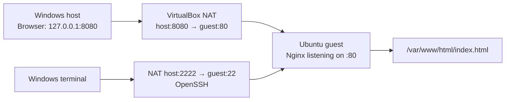

# Ubuntu / VirtualBox homelab

**Period:** October 2026  
**Environment:** Windows host, Oracle VirtualBox, Ubuntu guest VM, NAT, SSH and Nginx  
**Status:** Lab 01, 02 and 03 completed; Lab 04 installation/troubleshooting in progress

## Why I built it

I wanted to understand a real Linux system rather than only a network simulator: command-line administration, file permissions, service management, remote access, HTTP requests and the separation between application and networking faults.

## Lab 01 — VM, Linux fundamentals and SSH ✅

**Build:** Created a VirtualBox VM named `Ubuntu-Homelab-01`, using Ubuntu 26.04.1 and a NAT virtual network. Initial VM settings included 2 CPUs, 8 GB RAM and a 40 GB virtual disk.

**Hands-on:**
- Navigated directories and inspected files with `pwd`, `ls`, `ls -a` and `cat`.
- Created and edited practice files with shell redirection, including `echo ... > practice.txt`.
- Tested Unix file permission concepts with `chmod`; read permission bits through `ls -l`.
- Installed utilities and observed package installation with `apt`.
- Installed and started OpenSSH.
- Configured Windows → VirtualBox NAT forwarding with host TCP port `2222` forwarded to guest port `22`.
- Successfully signed into the Ubuntu guest from a Windows terminal via SSH.

**Observed evidence:** an earlier Windows terminal screenshot shows the Ubuntu login banner followed by `whoami`, `hostname` and `pwd`, all running inside the remote guest session.

**Learning:** a VM is a separate machine; local IP/port mappings differ from the guest's own service ports, and Linux permissions determine who can read or modify a file.

## Lab 02 — Nginx web server and remote update ✅

**Build:** installed and enabled Nginx, then served a local HTML page from `/var/www/html/index.html`.

**Verified:**
- Nginx running on guest port **80**.
- `curl` request from the guest returned **HTTP 200**.
- Port forwarding from Windows host `127.0.0.1:8080` to guest port `80`.
- Windows browser successfully loaded `http://127.0.0.1:8080/index.html`.
- Edited the served HTML remotely after signing in over SSH; verified the changes.

**Architecture:**



**Learning:** the browser uses the **host** port, whereas Nginx listens on the **guest** port. Being able to SSH does not prove that a web server is running.

## Lab 03 — Break it, diagnose it, repair it ✅

Deliberately introduced three independent faults and restored the service. See [detailed troubleshooting report](TROUBLESHOOTING.md).

| Fault | Symptom | Diagnosis and repair |
| --- | --- | --- |
| Stop Nginx | Website unavailable; SSH still worked | `systemctl` check; `sudo systemctl start nginx` |
| Incorrect HTTP port mapping | Windows browser failed while guest `curl` still got HTTP 200 | Guest web process healthy; correct forwarding back to **8080 → 80** |
| Remove page read permission | **HTTP 403 Forbidden** | `chmod 600` prevented web server from reading page; restored `chmod 644` |

**Learning:** make one change at a time, validate the exact failed layer, then undo the deliberate fault and prove normal operation has returned.

## Lab 04 — Second VM troubleshooting ⏳

Attempted to set up a second Ubuntu VM to extend the homelab. The Ubuntu 26.04.1 installation repeatedly stalled with a graphics/virtual-device-related issue (including `vmwgfx` messages). Instead of treating the VM as finished, I deleted the broken second VM and started rebuilding it using Ubuntu 24.04.5.1, with 4 GB RAM.

**Status as of 27 October 2026:** rebuild started; **not documented as a completed two-VM network or deployed service**.

## Key commands I practised

```bash
pwd
ls -la
cat practice.txt
chmod 600 practice.txt
sudo apt install curl
sudo systemctl status nginx
sudo systemctl start nginx
sudo ss -ltnp
curl -I http://127.0.0.1
```

These commands are reference examples from the training tasks and screenshots, not a shell history export.

## Next work

Finish Lab 04, learn VM-to-VM networking, avoid exposing SSH/HTTP externally without appropriate security controls, add sanitized terminal logs/screenshots, and capture a reproducible build checklist.

**Evidence:** authentic chat screenshots were inspected for SSH login, Nginx listening on TCP port 80 and HTTP 200 output, but original image binaries are still absent from this repo; see [evidence register](../EVIDENCE.md).
