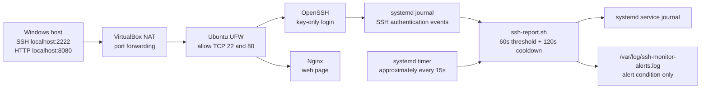

# Project 10 — Ubuntu Server Security & SSH Monitoring

**Date:** 15 November 2026  
**Environment:** Windows host, Oracle VirtualBox NAT, Ubuntu 26.04.1 LTS guest, Nginx, OpenSSH, UFW, Bash, systemd  
**Status:** Firewall and SSH hardening tested; scheduled reporting verified; detection and cooldown logic tested with synthetic examples; full live positive-alert path not yet tested.

## Overview

After completing a series of Cisco networking labs, I returned to my Ubuntu homelab to practise server hardening and log monitoring. I audited exposed services, configured UFW, switched SSH from account-password access to Ed25519 key authentication, and built a Bash script that reports SSH events and warns about a short burst of SSH authentication-related connection resets.

The timer runs the script automatically while Ubuntu is powered on. This is a **learning lab**, not a complete intrusion-detection system and not a production deployment.

## Architecture



## Verified work

| Component | Observation |
|---|---|
| Service inventory | `ss -tulpn` showed SSH TCP 22, Nginx TCP 80, CUPS localhost, local DNS and other processes |
| UFW | Active; default **deny incoming / allow outgoing**; explicit TCP 22 and 80 allows, including IPv6 |
| Local Nginx test | `curl -I http://127.0.0.1` produced HTTP 200 |
| Windows-to-guest HTTP | Host `127.0.0.1:8080` forwarded to guest :80; browser displayed homelab HTML page, `curl.exe -I` returned HTTP 200 |
| Windows-to-guest SSH | Host `127.0.0.1:2222` forwarded to guest :22; worked after enabling UFW |
| Key generation | Windows Ed25519 private/public key pair with passphrase |
| Key-only SSH after reload | Login accepted when password fallback was disabled client-side |
| Password-only SSH after reload | Rejected with `Permission denied (publickey)` |
| Effective SSH settings | `PubkeyAuthentication yes`, `PasswordAuthentication no`, `KbdInteractiveAuthentication no`, `PermitRootLogin no` |
| Initial SSH log summary | 2 accepted passwords, 3 accepted public keys, 0 `Failed password` messages, 1 authenticating-user reset |
| systemd timer | `active (waiting)`; repeated starts/finishes about every 16 seconds, confirmed in journal |
| Cooldown test | Synthetic time 0/60/120/180 seconds produced alert/suppress/alert/suppress |
| Distributed activity test | Eight synthetic events across four example IPs; overall threshold fired while per-IP thresholds did not |

The real log's source IP `10.0.2.2` was consistent with local VirtualBox NAT rather than evidence of a real attack.

## Project files

- [scripts/ssh-report.sh](scripts/ssh-report.sh) — Bash security report and **global** connection-reset cooldown, reconstructed from the screenshots of the working script.
- [systemd/ssh-monitor.service](systemd/ssh-monitor.service) — one-shot root-runner service definition.
- [systemd/ssh-monitor.timer](systemd/ssh-monitor.timer) — schedules the service after boot and after each completed run.
- [tests/mock-cooldown.sh](tests/mock-cooldown.sh) — independent synthetic cooldown simulation.
- [tests/mock-distributed.sh](tests/mock-distributed.sh) — separate multi-IP counting prototype; **not part of the installed live monitor**.

**Source provenance:** The script and service definitions were transcribed/reconstructed from this guided terminal session and successful command outputs. They are not original uploaded exports from the VM; compare them with the local files before redeployment. The mock test scripts are recreated reproducible versions of the commands tested interactively.

## Setup (for an isolated lab VM)

1. Verify `ssh`, systemd journal access and a recovery method via the VirtualBox console.
2. Read and inspect the script; do not paste private keys, credentials or identifiable authentication logs into a public repository.
3. Install the script as **root-owned** and not editable by normal users:
   ```bash
   sudo install -o root -g root -m 755 scripts/ssh-report.sh /usr/local/sbin/ssh-report.sh
   sudo touch /var/log/ssh-monitor-alerts.log
   sudo chmod 600 /var/log/ssh-monitor-alerts.log
   ```
4. Copy the unit files to `/etc/systemd/system/`; then run:
   ```bash
   sudo systemctl daemon-reload
   sudo systemctl enable --now ssh-monitor.timer
   systemctl status ssh-monitor.timer --no-pager
   sudo journalctl -u ssh-monitor.service -n 25 --no-pager
   ```
5. To stop scheduled checks: `sudo systemctl disable --now ssh-monitor.timer`.

Keep the VM console available when changing SSH/UFW rules to prevent accidental lockout.

## Design choices and limitations

- Counts **selected text patterns** in `journalctl -u ssh`, not all unsuccessful authentications. In particular, zero `Failed password` messages does not mean zero failed connections.
- The 60-second check combined with a 15-second timer improves coverage of short bursts but doesn't guarantee zero missed events.
- The first version checked daily totals; the improved script uses the last 60 seconds for the alert.
- Uses a **single global** 120-second cooldown in `/run`, resetting after reboot. It may suppress a distinct incident.
- The alert counts connection resets, which can have benign causes; it **does not prove an attack**.
- The distributed-activity `awk` test succeeded on synthetic records, but was not integrated into the live monitor.
- No positive end-to-end test yet demonstrates that the live service writes an alert to `/var/log/ssh-monitor-alerts.log`. The file was observed empty under normal operation.
- A compromised root account may be able to alter local logs; remote protected log collection would improve resilience.
- Service runs only when the Ubuntu VM is powered on. It does not recover events during a powered-off period.
- No error checking for journal-read failures. An empty or inaccessible journal could be incorrectly interpreted as no activity.
- UFW allows SSH from any source that can reach the guest. Port forwarding is bound to Windows localhost in this lab; this isn't a production perimeter control.
- A separate future priority is to review available Ubuntu security updates and validate a safe patch/reboot process.

## Next improvements

Perform an **end-to-end positive-alert test** using an injectable test-log source without altering real SSH logs; add per-IP and global event windows; deduplicate by incident/source rather than only by a global cooldown; harden the unit and alert-log handling; and forward alerts to an independent log collector.

## What I learned

The project taught me the difference between authentication and encryption, how UFW handles established outbound-initiated connections, why `127.0.0.1` is scoped to the machine executing a command, and how a systemd timer can schedule a one-shot service independently of an SSH terminal. It also illustrated alert fatigue, short-window threshold weaknesses and why anomalous logs require investigation rather than automatic attribution to an attacker.

Related: [Ubuntu / VirtualBox homelab](../README.md).
