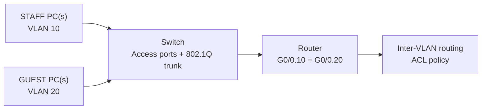

# Cisco Packet Tracer — 8 progressive networking labs

**Period:** September–October 2026  
**Tools:** Cisco Packet Tracer, PCs, switches, routers, simulated server, terminal/CLI  
**Status:** eight guided exercises completed; original `.pkt` projects not yet committed

## Objective

Learn how real networks move traffic and how to diagnose basic connectivity problems. The exercises grew from a simple LAN to a segmented STAFF/GUEST network with inter-VLAN routing, access control and controlled faults.

> **Scope:** all devices and tests took place inside Packet Tracer, not on deployed production hardware. IP configurations below describe the lab scenarios and may vary between exercises.

## Progression

### 01 — First LAN: switching and local connectivity

**Built:** two PCs connected via a switch. Example host addresses from the exercise: `192.168.1.10/24` and `192.168.1.20/24`.

**Test:** ping between hosts on the same subnet.

**Learnt:** devices in the same LAN can communicate via Layer 2 switching; addresses and subnet masks must agree. This did not require routing.

### 02 — Two networks connected with a router

**Built:** two different networks using a Cisco 1941 router, with gateway addresses `192.168.1.1` and `192.168.2.1`.

**Test:** pinged across subnets and checked host gateways/router interfaces.

**Observed:** a first ping could time out while the devices resolved addresses; subsequent replies succeeded. An isolated timeout is not always conclusive evidence of persistent failure.

**Learnt:** a switch connects devices within a LAN; routing and default gateways connect different networks.

### 03 — DHCP

**Built:** a `192.168.10.0/24` LAN with a router/DHCP configuration. The planned pool used gateway `192.168.10.1`, excluded `.1`–`.9` for infrastructure/static use, and handed out client parameters.

**Test:** client address acquisition and connectivity checks.

**Learnt:** DHCP reduces manual client configuration; exclusions prevent accidental assignment of reserved addresses.

### 04 — DNS and web service

**Built:** an HTTP/DNS server at `192.168.20.2` with an example hostname `company.local` resolving to the server.

**Test:** looked up/visited the server using an address and hostname within the simulated network.

**Learnt:** successful IP connectivity does not guarantee hostname resolution or an available web application; DNS and HTTP are separate services.

### 05 — VLAN isolation

**Built:** logical STAFF and GUEST networks on a managed switch:

| VLAN | Network | Purpose |
| --- | --- | --- |
| 10 | `192.168.10.0/24` | STAFF |
| 20 | `192.168.20.0/24` | GUEST |

**Test:** examined switchport VLAN assignment and checked whether traffic crossed VLAN boundaries before routing was configured.

**Learnt:** VLANs split a switch into separate broadcast domains; connecting ports to the same physical switch does not automatically connect all VLANs.

### 06 — Router-on-a-stick: inter-VLAN routing

**Built:** an 802.1Q trunk between switch and router. Configured router subinterfaces, including `GigabitEthernet0/0.10` and `GigabitEthernet0/0.20`, acting as the gateways for the two networks. The exercise used `Fa0/5` as a trunk link on the switch.

**Test:** inter-VLAN pings after configuring tagging and gateways.

**Learnt:** the trunk carries multiple VLANs; tagged router subinterfaces route between them. VLAN separation alone is not a traffic-blocking firewall rule once routing is enabled.

### 07 — ACL: GUEST and STAFF policy

**Built:** an access control list on the routed VLAN setup to prevent **GUEST-initiated access to STAFF**, while permitting traffic allowed by the exercise's wider policy.

**Test:** attempts to reach STAFF from GUEST should fail when the rule is correctly applied, with permitted traffic still functioning.

**Learnt:** packet-filter direction and order matter; deny rules need to be placed and applied correctly. This was a simulation of segmentation policy, not proof of enterprise firewall security.

### 08 — Troubleshooting a deliberately broken network

**Built/tested:** explored three injected fault types:

1. **Incorrect host default gateway** — check host settings and same-subnet reachability before blaming the router.
2. **Incorrect switchport VLAN** — verify access port membership rather than assuming cable connectivity means correct logical network.
3. **Administratively disabled router subinterface** — `show ip interface brief` exposes a subinterface that is down even when the parent interface is up; `no shutdown` is the relevant repair after verifying the cause.

The screenshot from this exercise shows a router subinterface administratively down and a Packet Tracer ping that received **3 of 4 replies**; the first timed out. The screenshot is an observed intermediate test, **not** a claim of 0% packet loss.

**Learnt:** a disciplined workflow is more reliable than changing random settings.

## Example topology (conceptual, not a screenshot)

## Troubleshooting method

1. Check link/device power and interface status.
2. Verify host IP address, mask and default gateway.
3. Verify access VLAN and trunk settings.
4. Check router interface/subinterface status and routes.
5. Test progressively: same LAN → default gateway → other VLAN → DNS/application.
6. When testing ACLs, check **both** the traffic that should be denied and traffic that should remain allowed.

See [testing notes and command reference](TESTS.md).

## What I would improve next

Export the eight `.pkt` files, save sanitized `show run` / `show vlan brief` / `show interfaces trunk` output, add dated screenshots for each test, and repeat the builds from memory without guided prompts. Future work: DHCP relay, more precise extended ACL verification and basic network monitoring.

**Evidence status:** authentic screenshots were reviewed from my earlier ChatGPT sessions, but the image files and Packet Tracer projects have **not** yet been committed to this repository. See [evidence register](../EVIDENCE.md).
