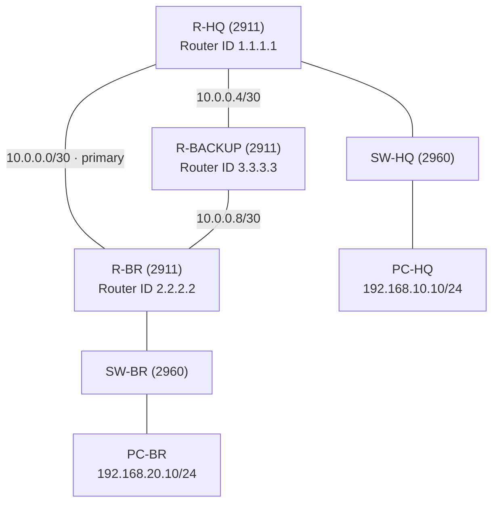
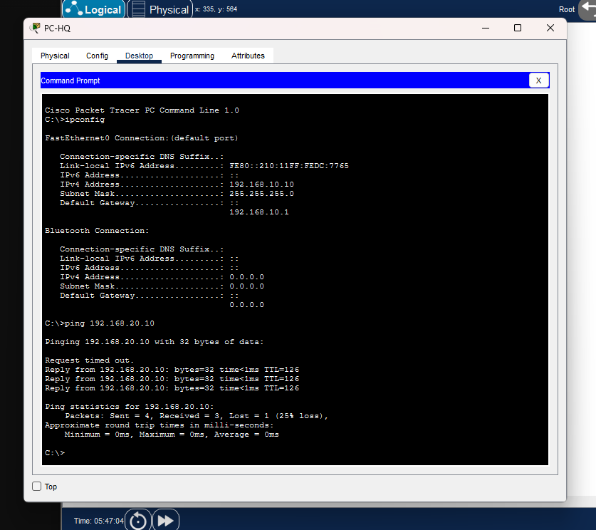

# Cisco Project 10 — OSPF Redundancy, Automatic Failover & Failback

**Built and tested:** 21 November 2026  
**Environment:** Cisco Packet Tracer; three 2911 routers, two 2960 switches, two PCs  
**Status:** Guided simulation built; OSPF adjacency, route failover, automatic failback and PC-to-PC reachability evidenced. The uploaded binary is hash-verified but not independently reopened in Packet Tracer here.

[**Download the original Packet Tracer project**](project-10-ospf-failover.pkt) · [Network plan](NETWORK-PLAN.md) · [Testing evidence](TEST-RESULTS.md) · [Troubleshooting](TROUBLESHOOTING.md) · [Rebuild configuration guide](CONFIGURATION.md)

## Goal

Build a small two-office network where **HQ and Branch have a direct primary link and an alternate path through a third router**. Use OSPF area 0 so traffic normally takes the preferred route, and routing reconverges if that direct connection fails.

## Topology

The physical router triangle is the redundancy mechanism. OSPF performs dynamic route selection and can use the alternate path after a failed link.

## What I configured

- Three separate routed **/30** transit networks, one per router-to-router link.
- Two **/24** LANs: HQ `192.168.10.0/24` and Branch `192.168.20.0/24`.
- OSPF process 1, **area 0**, with Router IDs `1.1.1.1`, `2.2.2.2`, `3.3.3.3`.
- Passive OSPF LAN interfaces on HQ and Branch (advertised LANs; no OSPF neighbour formation with PCs).
- Primary path with OSPF **cost 2** to the Branch LAN; alternate path with **cost 3**, as observed in the R-HQ route table.

## Verified outcomes

| Test | Observed result |
|---|---|
| Router-to-router connectivity | Direct neighbour pings succeeded; several initially returned **4/5** due to one timeout |
| Initial OSPF | HQ and Branch established **FULL** adjacency |
| Backup OSPF | R-BACKUP established **FULL** adjacencies with both neighbours |
| Primary routing | `192.168.20.0/24 [110/2] via 10.0.0.2` |
| Deliberate link failure | `shutdown` on **R-HQ G0/0**; OSPF neighbour `2.2.2.2` went from FULL to DOWN |
| Automatic failover | Branch LAN route changed to `[110/3] via 10.0.0.6` (R-BACKUP) |
| Gateway reachability during failover | R-HQ ping `192.168.20.1`: **5/5** after convergence |
| Link restoration | `no shutdown` on R-HQ G0/0; adjacency progressed through INIT and reached **FULL** |
| Automatic failback | Preferred route restored to `[110/2] via 10.0.0.2`, with **5/5** gateway pings |
| End-to-end PCs (after failback) | PC-HQ `192.168.10.10` to PC-BR `192.168.20.10`: **3/4 replies**, first request timed out |

[See the genuine PC-to-PC screenshot](assets/pc-hq-to-pc-br-ping.png) and [detailed test log](TEST-RESULTS.md).

## What I learned

OSPF chooses routes by total OSPF cost, not directly by physical distance or packet latency. Losing a direct link caused OSPF to replace its path to a remote LAN through the third router; when the primary link returned, the lower-cost route was installed again. A higher backup cost did not prevent successful connectivity.

The project also demonstrated that **redundancy is not unlimited fault tolerance**: losing both the primary connection and the alternate path would disconnect the offices. Constantly failing and recovering links can cause route flapping, repeated reconvergence and interruptions.

## Files

- [`project-10-ospf-failover.pkt`](project-10-ospf-failover.pkt) — **original uploaded Cisco Packet Tracer simulation**, 57,432 bytes. SHA-256: `a0238464daaf2d7e0893a98856ecb9e6d1ee68d932fe6430183de0d0163d7076`.
- [`assets/pc-hq-to-pc-br-ping.png`](assets/pc-hq-to-pc-br-ping.png) — screenshot from the actual guided end-to-end ping.
- [`NETWORK-PLAN.md`](NETWORK-PLAN.md) — cable/interface mapping and IP table.
- [`TEST-RESULTS.md`](TEST-RESULTS.md) — before, during and after failure observations.
- [`CONFIGURATION.md`](CONFIGURATION.md) — **reconstructed** configuration commands for reproducing the exercise.
- [`TROUBLESHOOTING.md`](TROUBLESHOOTING.md) — mistakes, diagnosis and fixes.

## Verification boundaries / next steps

The uploaded project binary matches the user-supplied file byte for byte. I did **not** independently execute the saved `.pkt` in Packet Tracer after upload, or export running configurations from the file. The record above is based on the terminal screenshots from the actual guided session.

The **PC-to-PC ping was tested after the primary link had returned**, not during the failure; the mid-failure test was R-HQ to Branch's router LAN interface. A useful extension is to run continuous PC-to-PC pings while shutting down and restoring the primary link, count any dropped packets and measure recovery time. Additional screenshots could capture `show ip route ospf` in each state.

**Educational simulation only**, not an operational enterprise WAN or a production high-availability design.

[Back to networking portfolio](../README.md).
