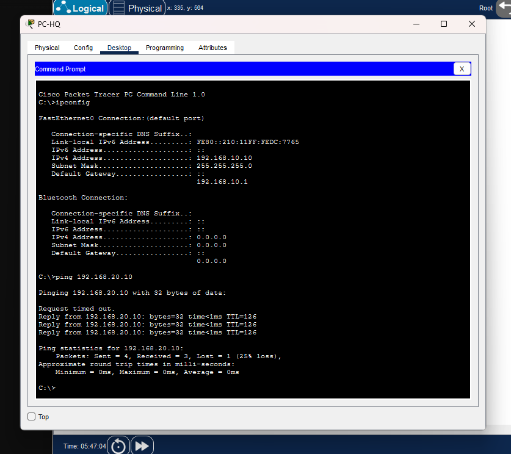

# Test results — Project 10

**Observed during guided Packet Tracer session, 21 November 2026.** These records reflect actual screenshots and user testing, not a fresh headless test of the uploaded binary.

## Phase 1 — Direct physical links

| Source | Destination | Observed |
|---|---|---|
| R-HQ | R-BR (10.0.0.2) | 4/5 ICMP replies |
| R-HQ | R-BACKUP (10.0.0.6) | 4/5 ICMP replies |
| R-BR | R-BACKUP (10.0.0.10) | 4/5 ICMP replies |

Initial timeouts were **consistent with address resolution**, not conclusively proved to be ARP.

## Phase 2 — OSPF adjacencies and initial routing

- On R-BR, `show ip ospf neighbor` showed Router ID `1.1.1.1` at address `10.0.0.1` with state `FULL/DR`.
- On R-BACKUP, both `1.1.1.1` (`10.0.0.5`) and `2.2.2.2` (`10.0.0.9`) reached `FULL/DR`.
- R-HQ's route to Branch LAN: `O 192.168.20.0 [110/2] via 10.0.0.2, GigabitEthernet0/0`.
- R-BR's reverse route to HQ LAN: `O 192.168.10.0 [110/2] via 10.0.0.1, GigabitEthernet0/0`.
- R-HQ ping to Branch LAN gateway `192.168.20.1`: **5/5 replies** before the failure.

## Phase 3 — Primary-link shutdown / failover

Command on R-HQ:

```ios
configure terminal
interface GigabitEthernet0/0
 shutdown
end
```

The interface changed state to administratively down, and OSPF reported neighbour `2.2.2.2` transitioning from FULL to DOWN due to interface down/detachment.

**Route after convergence:**

```text
O 192.168.20.0 [110/3] via 10.0.0.6, GigabitEthernet0/1
```

**Connectivity after convergence:** R-HQ ping to `192.168.20.1` returned **5/5** replies, demonstrating that the backup route could reach the Branch router LAN interface.

This does not establish zero packet loss *during* convergence, and no convergence duration was measured.

## Phase 4 — Restore primary / failback

Command on R-HQ:

```ios
configure terminal
interface GigabitEthernet0/0
 no shutdown
end
```

Early output showed neighbour `2.2.2.2` in `INIT/DROTHER`; a later log showed `LOADING to FULL`. A subsequent `show ip ospf neighbor` displayed both direct and backup neighbours as **FULL**.

**Route after convergence:**

```text
O 192.168.20.0 [110/2] via 10.0.0.2, GigabitEthernet0/0
```

**Connectivity:** R-HQ to `192.168.20.1` again returned **5/5** replies.

## Phase 5 — PC-to-PC reachability (after failback)

PC-HQ `ipconfig`:

- IPv4: `192.168.10.10`
- Mask: `255.255.255.0`
- Gateway: `192.168.10.1`

Command:

```text
ping 192.168.20.10
```

Observed responses: one **Request timed out**, then three replies from `192.168.20.10` with `TTL=126` and `time<1ms`.

**Result:** 3 received / 4 sent, 25% packet loss on this particular four-packet test. This establishes remote PC reachability but is **not** a claim of 100% delivery.



## Outstanding tests

- End-to-end **PC-HQ → PC-BR** reachability *while the primary link is disabled* (only router-to-router/LAN-gateway reachability was verified in backup mode).
- Repeated pings or an extended flow through shutdown and recovery to estimate loss and convergence time.
- Failure of R-BACKUP itself, failure of a LAN connection and multi-failure behaviour.
- Fresh independent re-opening/retesting of `project-10-ospf-failover.pkt` after upload.

[Back to Project 10](README.md).
